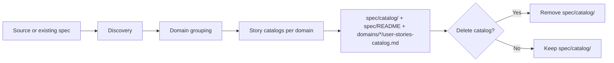

## MANDATORY PREREQUISITE (execute automatically, do not skip)

Before doing anything else, execute the `/tanzu-shared` skill. Do not ask the user. Do not skip this step.

# Tanzu Extract Story Catalog

Build a Git-storable catalog of user stories by domain so that starting extraction or translation of a single story requires minimal context (load catalog, pick story, then load that story's spec).

## Quick Start

### What This Skill Does

1. **Discovery**: Scan the codebase once and write discovery catalogs under `spec/catalog/`.
2. **Domain grouping**: Group endpoints by business domain; write `spec/catalog/domain-mapping.md`.
3. **Story discovery**: For each domain, generate `spec/domains/{domain}/user-stories-catalog.md` (story ID, title, complexity, and source_files per story).
4. **Optional**: Delete `spec/catalog/` after organization so only `spec/README.md` and per-domain story catalogs remain in Git.

### What You Need

| Input | Required | Description |
|-------|----------|-------------|
| **Source code location** | For "from codebase" | Folder/repo containing the application to analyze |
| **Spec folder location** | Optional | Where to write output (default: `./spec`) |
| **Existing spec** | For "refresh from existing spec" | `spec/catalog/` must exist (discovery + domain-mapping) |

### Output Structure

```
spec/
├── README.md                          # Overview and domain index (story counts)
├── catalog/                           # Discovery + domain grouping (optional: delete after organization)
│   ├── endpoints-catalog.md
│   ├── services-catalog.md
│   ├── entities-catalog.md
│   ├── integrations-catalog.md
│   ├── scheduled-tasks-catalog.md
│   └── domain-mapping.md
└── domains/
    └── {domain-name}/
        ├── README.md                  # Domain overview (optional, minimal)
        └── user-stories-catalog.md     # Story list with source_files per story
```

If you **delete `spec/catalog/`** after organization, only `spec/README.md` and `spec/domains/*/user-stories-catalog.md` remain. Each story entry in `user-stories-catalog.md` **must** include **source_files** (paths relative to repo root) so [tanzu-extract-story-detail](/tanzu-extract-story-detail) can do detailed extraction without the discovery catalogs.

## Workflow



## When to Use

- **Create catalog**: Run from source code to build the full catalog (discovery → domain grouping → story catalogs).
- **Refresh catalog**: If `spec/catalog/` exists, re-run story discovery only and refresh `spec/domains/*/user-stories-catalog.md`.
- **Minimal Git**: After generating story catalogs, delete `spec/catalog/` so only domain index and story lists are stored (user-stories-catalog must include source_files per story).

## From Codebase

1. **Discovery** (scan once)
   - Use the [tanzu-extract-story-detail Detection Patterns](../tanzu-extract-story-detail/detection-patterns/README.md) to identify entry points, services, entities, integrations, scheduled tasks.
   - Write:
     - `spec/catalog/endpoints-catalog.md`
     - `spec/catalog/services-catalog.md`
     - `spec/catalog/entities-catalog.md`
     - `spec/catalog/integrations-catalog.md`
     - `spec/catalog/scheduled-tasks-catalog.md`
   - Optionally write `spec/non-recognized-components.md` (same-namespace dependencies).

2. **Domain grouping**
   - Load `spec/catalog/endpoints-catalog.md`.
   - Cluster endpoints by business domain.
   - Write `spec/catalog/domain-mapping.md`.

3. **Story discovery** (for each domain)
   - Load catalog entries for that domain's endpoints.
   - Derive user story list (ID, title, complexity).
   - For each story, record **source_files** (paths relative to repo root) from the discovery catalogs.
   - Write `spec/domains/{domain}/user-stories-catalog.md` and optionally `spec/domains/{domain}/README.md`.

4. **Domain index**
   - Write `spec/README.md` with overview and list of domains with story counts.

5. **Optional: delete `spec/catalog/`**
   - If you want minimal Git footprint, delete the folder `spec/catalog/` after step 4. Ensure every story in `user-stories-catalog.md` has **source_files** so tanzu-extract-story-detail can load files for detailed extraction without the discovery catalogs. After deletion, "refresh from existing spec" is no longer possible; refresh requires re-running this skill from the source folder.

## From Existing Spec (Refresh)

When `spec/catalog/` already exists (discovery catalogs + domain-mapping):

1. Load `spec/catalog/domain-mapping.md` and discovery catalogs.
2. For each domain, re-run story discovery and overwrite `spec/domains/{domain}/user-stories-catalog.md` (include source_files per story).
3. Update `spec/README.md` domain index if needed.

Do **not** delete `spec/catalog/` if you want to keep the ability to refresh without re-scanning the codebase.

## Output Contract

### spec/README.md

- Application/spec overview.
- **Domain index**: list of domains with story count per domain (e.g. "order-management (5 stories)").

### spec/domains/{domain}/user-stories-catalog.md

Each story entry must include:

- **ID** (e.g. US-001)
- **Title**
- **Complexity** (LOW | MEDIUM | HIGH | VERY_HIGH)
- **source_files** (array of paths relative to repo root) — required if `spec/catalog/` will be or has been deleted

Example format (table or list):

| ID     | Title        | Complexity | Source files                    |
|--------|--------------|------------|---------------------------------|
| US-001 | Create Order | MEDIUM     | src/.../OrderController.java, ... |

### spec/catalog/ (when kept)

- **endpoints-catalog.md**, **services-catalog.md**, **entities-catalog.md**, **integrations-catalog.md**, **scheduled-tasks-catalog.md**: Same structure as described in [tanzu-extract-story-detail Phase 1](/tanzu-extract-story-detail) (output paths under `spec/catalog/` instead of `_phase1-results/`).
- **domain-mapping.md**: Map of domain names to endpoint/catalog entries (same as tanzu-extract-story-detail Phase 2, path `spec/catalog/domain-mapping.md`).

## Relationship to Other Skills

- **tanzu-extract-story-detail**: Performs **detailed extraction** (Phase 3b). It expects the catalog to exist: either `spec/catalog/` + `spec/domains/*/user-stories-catalog.md`, or (if catalog was deleted) only `spec/domains/*/user-stories-catalog.md` with **source_files** per story. tanzu-extract-story-detail then uses AskQuestion for domain/story selection and loads source files from the story catalog (or from spec/catalog/ when present).
- **modernize**: Phase 1 of modernization runs **tanzu-extract-story-catalog** first, then **tanzu-extract-story-detail** for story selection and detailed extraction. The catalog in Git reduces context when starting a story.
- **tanzu-rewrite-story**: For minimal context, story selection can be driven from `spec/README.md` and `spec/domains/*/user-stories-catalog.md` (and optionally `spec/catalog/` if present).

## Summary

1. **Single catalog folder**: All discovery and domain-grouping outputs go under `spec/catalog/` (no per-phase directories).
2. **Optional deletion**: You may delete `spec/catalog/` after organizing into domains; then user-stories-catalog must include source_files per story.
3. **Refresh**: Possible only when `spec/catalog/` is kept; otherwise re-run from codebase.
4. **Detection patterns**: Use tanzu-extract-story-detail's detection-patterns for discovery; this skill does not duplicate them.
