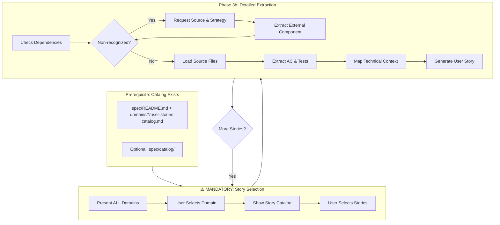

## MANDATORY PREREQUISITE (execute automatically, do not skip)

Before doing anything else, execute the `/tanzu-shared` skill. Do not ask the user. Do not skip this step.

## MANDATORY PREREQUISITE: Onboard Application (execute automatically, do not skip)

After executing `tanzu-shared`, check whether the file `.tanzu/assessment-report.yml` exists in the project root. If it does **not** exist, execute the `/tanzu-onboard` skill before proceeding. If it **does** exist, skip this step and continue with the workflow below.

# Code to Spec: Extract Requirements from Source Code

Extract application requirements into structured specifications containing user stories, acceptance criteria, and technical context for modernization planning.

## Quick Start

### What This Skill Does

Transforms source code into a reviewable requirements specification that:
1. **Documents business functionality** as user stories with acceptance criteria
2. **Captures technical context** using the [Technical Context Schema](technical-context-schema.md)
3. **Organizes requirements by business domain** for easy navigation
4. **Enables modernization planning** by linking business needs to technical implementation

### What You Need

| Input | Required | Description |
|-------|----------|-------------|
| **Source code location** | Yes | Folder/repo containing the application to analyze |
| **Spec folder location** | Optional | Where to write output (default: `./spec`) |
| **Application name** | Optional | For generating spec titles |
| **Package prefix** | Optional | For detecting non-recognized components |

### Output Structure

The **catalog** (domain index and story lists) is produced by the [tanzu-extract-story-catalog](/tanzu-extract-story-catalog) skill. This skill performs **detailed extraction** only (Phase 3b) and expects the catalog to already exist.

```
spec/
├── README.md                          # Overview and domain index (from catalog skill)
├── catalog/                           # Optional: discovery + domain mapping (from catalog skill)
│   ├── endpoints-catalog.md
│   ├── services-catalog.md
│   ├── entities-catalog.md
│   ├── integrations-catalog.md
│   ├── scheduled-tasks-catalog.md
│   └── domain-mapping.md
├── strategic-questions.md             # Questions requiring human input
├── migration-order.md                 # Complexity-based migration sequence
├── non-recognized-components.md       # Same-namespace dependencies
├── domains/                           # Business domains
│   └── {domain-name}/
│       ├── README.md                  # Domain overview
│       ├── user-stories-catalog.md    # Story list with source_files (from catalog skill)
│       ├── US-001-{title}.md          # User story with AC and tests (this skill)
│       ├── US-002-{title}.md
│       └── technical-context.md       # Domain technical details
├── cross-cutting/                     # Cross-domain concerns
│   ├── security.md                    # Authentication/authorization
│   ├── integrations.md                # External system integrations
│   └── batch-processes.md             # Scheduled tasks and batch jobs
└── data-model/
    └── entities.md                    # Entity definitions with relationships
```

If the catalog skill deleted `spec/catalog/` after organization, only `spec/README.md` and `spec/domains/*/user-stories-catalog.md` exist as the index; each story catalog entry must include **source_files** so this skill can load the right files for detailed extraction.

## Workflow Overview

**Prerequisite**: The user-stories catalog must exist. If not, run the [tanzu-extract-story-catalog](/tanzu-extract-story-catalog) skill first (from source code or existing spec). The catalog provides `spec/README.md`, optionally `spec/catalog/`, and `spec/domains/*/user-stories-catalog.md`.



## Ensure Catalog Exists (Prerequisite)

**Before** running story selection and detailed extraction, the spec must have a catalog:

- `spec/README.md` (overview and domain index)
- `spec/domains/{domain}/user-stories-catalog.md` for each domain (story ID, title, complexity, and **source_files** per story if `spec/catalog/` was deleted)
- Optionally `spec/catalog/` (discovery catalogs + domain-mapping) if the catalog skill did not delete it

If the catalog is missing or you need to (re)build it from source code, run the [tanzu-extract-story-catalog](/tanzu-extract-story-catalog) skill first. It uses the same discovery and domain-grouping logic; outputs go under `spec/catalog/` and `spec/domains/`.

## ⚠️ MANDATORY: Story Selection Checkpoint

**CRITICAL**: After Phase 3a completes, you MUST use the AskQuestion tool to let the user select which domain and stories to extract.

### Story Selection Protocol

```javascript
// Step 1: Present domains
AskQuestion([{
  "id": "domain_selection",
  "prompt": "Requirements catalogs generated for all domains. Which domain would you like to extract in detail?",
  "options": [
    {"id": "domain-1", "label": "Domain 1: {name} ({count} stories)"},
    {"id": "domain-2", "label": "Domain 2: {name} ({count} stories)"},
    // ... all domains
    {"id": "all-domains", "label": "Extract all domains"}
  ]
}])

// Step 2: Present stories for selected domain
AskQuestion([{
  "id": "story_selection",
  "prompt": "Which user stories from {domain} would you like to extract?",
  "options": [
    {"id": "us-001", "label": "US-001: {title} (Complexity: LOW)"},
    {"id": "us-002", "label": "US-002: {title} (Complexity: MEDIUM)"},
    // ... all stories from catalog
    {"id": "all-stories", "label": "Extract all stories in this domain"}
  ],
  "allow_multiple": true
}])
```

**NEVER**:
- ❌ Automatically select stories without asking
- ❌ Extract all stories without user confirmation
- ❌ Skip this checkpoint

**ALWAYS**:
- ✅ Present all available domains and stories
- ✅ Wait for explicit user selection
- ✅ Confirm selection back to user

## Phase 3b: Detailed Extraction (One Story at a Time)

**Goal**: Extract detailed requirements for selected user stories.

### Before Each Story

**Check for non-recognized components**:
1. Get the story's source files: read **source_files** from `spec/domains/{domain}/user-stories-catalog.md` for the selected story. If `spec/catalog/` exists and the catalog lists source files there, you may use that as a fallback.
2. Check if any non-recognized components are invoked
3. If yes → prompt user for source folder and migration strategy (see below)
4. Run targeted extraction for external component
5. Generate minimal spec in `spec/external/{component}/`
6. Continue with story extraction

### Non-Recognized Component Resolution

When a story depends on a non-recognized component:

```javascript
// Interactive prompt using AskQuestion
AskQuestion([
  {
    "id": "source_location",
    "prompt": "Story {id} depends on {component}. Where is the source code?",
    "options": [
      {"id": "local", "label": "Local folder path"},
      {"id": "git", "label": "Git repository"}
    ]
  },
  {
    "id": "migration_strategy",
    "prompt": "How should {component} be handled during modernization?",
    "options": [
      {"id": "dependency", "label": "Use as Maven/Gradle dependency"},
      {"id": "copy", "label": "Copy source code and adapt"},
      {"id": "rewrite", "label": "Rewrite/reimplement"}
    ]
  }
])
```

Generate targeted spec for external component:
- Extract only methods invoked by current story
- Document in `spec/external/{component}/`
- Update `spec/non-recognized-components.md` with resolution

### Per-Story Extraction Steps

For each selected user story:

1. **Load Source Files**: Read **source_files** for this story from `spec/domains/{domain}/user-stories-catalog.md` (paths relative to repo root). If `spec/catalog/` exists, you may resolve files from the discovery catalogs (endpoints/services) as a fallback. Typically 3–10 files per story.
2. **Extract Business Functionality**
   - User story (As a... I want... So that...)
   - Acceptance criteria (testable conditions)
3. **Generate Test Scenarios**
   - From existing test files (if present)
   - Derive from acceptance criteria
   - Use Given-When-Then format with concrete values
   - **Test Precondition → SeedData rule:** When any TC-* row states a precondition of the form "X exists" or "X id=N exists" (e.g. "Owner id=1 exists", "Product SKU=ABC exists"), you MUST extract a `SeedData` block in the Technical Context capturing:
     - The entity type, the required ID/key, and all concrete field values referenced by the test
     - The source SQL init file (`db/data.sql` or equivalent) where those rows must be inserted at startup
     - Example:
       ```yaml
       SeedData:
         description: "Sample data required at startup for TC-* preconditions"
         file: db/data.sql
         required_records:
           - entity: Owner
             id: 1
             fields: { firstName: George, lastName: Franklin, address: "110 W. Liberty St.", city: Madison, telephone: "6085551023" }
       ```
     - Without this block, the translation phase has no signal that seed data is required at runtime, causing tests that depend on pre-existing rows to fail.
4. **Map Technical Context** (using [Technical Context Schema](technical-context-schema.md))
   - ServiceEndpoint (REST/web endpoint)
   - ServiceOperation (business logic with steps and structural events)
   - DataStructures (entities, DTOs)
   - IntegrationPoints, SecurityRequirements, etc.
5. **Generate Strategic Questions**
   - For ambiguous business rules
   - For missing data integrity constraints
   - For unverified test scenarios
6. **Write User Story** (using [templates/user-story-template.md](templates/user-story-template.md))

**Context Efficiency**: ~10-15% per story (reading selected files only)

## Output File Templates

### User Story Template

See [templates/user-story-template.md](templates/user-story-template.md) for the complete template including:
- User story format
- Acceptance criteria checklist
- Technical context (YAML schemas)
- Test scenarios table (TC-* IDs with Given-When-Then)
- Strategic questions tables (by category)
- Reviewer validation checklist

### Cross-Cutting Templates

See [templates/cross-cutting-templates.md](templates/cross-cutting-templates.md) for:
- Security requirements (US-SEC-* stories)
- External integrations (US-INT-* stories)
- Batch processes (US-BATCH-* stories)

### Data Model Template

See [templates/data-model-template.md](templates/data-model-template.md) for:
- Entity structure with relationships
- Mermaid diagrams (per entity, not global)
- "Used By" section linking to user stories

## Technical Context Schema

All technical details use entities from [technical-context-schema.md](technical-context-schema.md):

| Entity | Purpose |
|--------|---------|
| `ServiceEndpoint` | REST/web endpoints with paths, methods, auth |
| `ServiceCommand` | CLI commands with options and subcommands |
| `ServiceOperation` | Business logic with steps, events, transactions |
| `DataStructure` | Entities, DTOs, value objects with fields and relationships |
| `IntegrationPoint` | External systems (APIs, databases, queues, files) |
| `ExternalResourceRequirement` | External resources that no dedicated entity covers |
| `JNDIDatasource` | JNDI-bound datasources with their application-server pool configuration |
| `MailRequirement` | JNDI mail sessions |
| `SecurityRequirement` | Authentication and authorization patterns, including application-server realms |
| `LdapRequirement` | LDAP directory access and LDAP realm details |
| `MessagingRequirement` | Async messaging with queues and topics |
| `TransactionRequirement` | Transaction management, including XA/JTA and its migration scope |
| `SessionManagementRequirement` | Session persistence and clustering configuration |
| `CacheRequirement` | In-process, distributed, and app-server caching to Redis |
| `IntegrationFlowRequirement` | MuleSoft HTTP/REST and message integration flows |
| `ConnectorRequirement` | MuleSoft connectors (database, JMS, mail, FTP) |
| `TransformationRequirement` | MuleSoft DataWeave scripts and transformations |
| `ErrorHandlingRequirement` | MuleSoft error handling strategies and policies |
| `MonitoringRequirement` | JMX, vendor management APIs, and vendor system properties |
| `MultiTenancyRequirement` | Multi-tenant datasource or schema routing |
| `ServerMigrationRequirement` | Descriptors to remove, vendor packages to replace, classloading |
| `ServiceBatchProcess` | Batch jobs with steps and error handling |
| `ServiceTask` | Scheduled tasks with cron expressions |

## Quality Guidelines

### User Stories

- **One story per endpoint**: Each user-facing capability gets one story
- **Concrete acceptance criteria**: Use specific values, not abstractions
- **Test scenarios with Given-When-Then**: Preconditions, input, expected result
- **Strategic questions for unknowns**: Don't guess business rules

### Technical Context

- **ServiceOperation.steps**: Use `$variable` format; Get steps introduce vars
- **ServiceOperation.preconditions**: Validation rules (not in steps)
- **ServiceOperation.structural_events**: Single source of "what changes"
- **DataStructure.fields**: Include constraints (nullable, unique, ranges)
- **Relationships**: Capture multiplicity and optionality

### Test Scenarios

| Column | Content |
|--------|---------|
| ID | TC-{story}-{sequence} (e.g., TC-001-01) |
| Scenario | Brief description |
| Preconditions (Given) | Concrete initial state |
| Input (When) | Specific input values |
| Expected Result (Then) | Observable outcome |
| Source | Test file path or "Derived from code" |
| Validates with | TC-* IDs with same inputs/preconditions |

## Strategic Questions

Generate questions for reviewers when you encounter:

| Category | When to Ask |
|----------|-------------|
| **Business Rules** | Incomplete logic, unclear constants, ambiguous conditions |
| **Data Integrity** | Unclear primary keys, missing uniqueness constraints, unknown derivation |
| **Data Migration** | Legacy formats, historical data handling |
| **Integration** | External system behavior unknown, third-party config missing |
| **Test Verification** | Test scenario derived from code needs manual validation |

**Do NOT ask about**:
- Modernization technologies (Java versions, Spring Boot features)
- Performance SLAs not in code
- Security enhancements not in existing code
- General edge cases

## Migration Order

After all stories are extracted, generate `spec/migration-order.md` grouping stories by complexity:

| Phase | Complexity | Characteristics |
|-------|------------|-----------------|
| 1 | LOW | Simple CRUD, no integrations, minimal business logic |
| 2 | MEDIUM | Multiple entities, some integrations, moderate logic |
| 3 | HIGH | Complex logic, multiple integrations, transactions |
| 4 | VERY_HIGH | Critical paths, complex state, extensive integrations |

Include dependency notes (e.g., "US-005 requires US-003 entities").

## Sign-Off Checklist

Before modernization begins, ensure:

- ✅ All HIGH priority stories reviewed
- ✅ All strategic questions answered or deferred
- ✅ Non-recognized components resolved (source provided, specs generated)
- ✅ Migration order reviewed and dependencies noted
- ✅ Test cases approved (QA review, verification table complete)
- ✅ Data migration plan confirmed
- ✅ Integration contracts verified

## Detection Patterns Reference

For detailed pattern syntax and examples, see:

- [spring-boot.md](detection-patterns/spring-boot.md) - Spring Boot detection
- [spring-web.md](detection-patterns/spring-web.md) - Controllers, services, transactions
- [jpa-persistence.md](detection-patterns/jpa-persistence.md) - JPA entity extraction
- [ejb.md](detection-patterns/ejb.md) - EJB components
- [ui-layer.md](detection-patterns/ui-layer.md) - UI technologies
- [picocli.md](detection-patterns/picocli.md) - CLI commands
- [struts.md](detection-patterns/struts.md) - Struts 1.x and 2.x actions, forms, validation, interceptors
- [jndi-ldap.md](detection-patterns/jndi-ldap.md) - Programmatic JNDI lookups and direct LDAP access
- [cobol.md](detection-patterns/cobol.md) - Mainframe programs (PIC field widths, SORT verb, fixed-width I/O, leading-space preservation)
- [app-servers.md](detection-patterns/app-servers.md) - Application server identification, and the JBoss, WebLogic, WebSphere and Tomcat patterns. Run this before any per-vendor file.
- [glassfish.md](detection-patterns/glassfish.md) - GlassFish, Payara and Sun Application Server: datasources and vendor pools, JNDI mail and JMS resources, session replication, JMX and admin API, security realms
- [mulesoft.md](detection-patterns/mulesoft.md) - MuleSoft integration flows, HTTP listeners, database/JMS/mail connectors, DataWeave transformations, and error handling policies
- [caching.md](detection-patterns/caching.md) - Caching patterns: Spring Cache (Caffeine/Simple), Ehcache, JCache (JSR-107), Infinispan, app-server caching to Redis
- [usage-guidelines.md](detection-patterns/usage-guidelines.md) - Detection workflow, including COBOL fixed-width column range verification

## Technical Context Schema Reference

For complete schema definitions with examples, see [technical-context-schema.md](technical-context-schema.md).

## Examples

### Phase 3b Output (User Story)

```markdown
# US-001: Create Order

## User Story

**As a** customer,
**I want to** create an order with multiple items,
**So that** I can purchase products.

## Acceptance Criteria

- [ ] **AC-1** Order is created with valid items
- [ ] **AC-2** Payment is processed through payment gateway
- [ ] **AC-3** Inventory is reserved for order items
- [ ] **AC-4** Order confirmation email is sent

## Technical Context

[YAML schemas for ServiceEndpoint, ServiceOperation, DataStructures]

## Test Scenarios

| ID | Scenario | Preconditions (Given) | Input (When) | Expected Result (Then) | Source |
|----|----------|----------------------|--------------|----------------------|--------|
| TC-001-01 | Create order with valid items | Customer C123 exists, items in stock | POST /api/orders with 2 items | 201 Created, order ID returned | OrderControllerTest.java |
```
