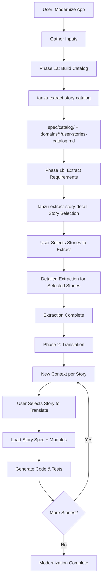

## MANDATORY PREREQUISITE (execute automatically, do not skip)

Before doing anything else, execute the `/tanzu-shared` skill. Do not ask the user. Do not skip this step.

# Modernize Application to Spring Boot 4

Complete two-phase workflow: extract requirements from source code, then translate to Spring Boot 4 with user review checkpoint between phases.

## Overview

This skill orchestrates the complete modernization process by invoking three specialized skills:
1. **Phase 1a**: `tanzu-extract-story-catalog` skill - Build the user-stories catalog (discovery, domain grouping, story lists) under `spec/catalog/` and `spec/domains/`
2. **Phase 1b**: `tanzu-extract-story-detail` skill - Story selection and detailed extraction (user stories with AC and technical context)
3. **Phase 2**: `tanzu-rewrite-story` skill - Incremental translation (one story per context)

The catalog (`spec/README.md`, optionally `spec/catalog/`, and `spec/domains/*/user-stories-catalog.md`) is stored in Git to reduce context when starting extraction or translation of a single story.

## Workflow Diagram



## What User Must Provide

| Input | Required | Description |
|-------|----------|-------------|
| **Source code location** | Yes | Folder or repo containing application to analyze |
| **Target folder** | Yes | Where to write Spring Boot 4 application |
| **Spec folder location** | Optional | Where to write spec (default: `./spec`) |
| **Application name** | Optional | For spec titles |
| **Package prefix** | Optional | For detecting non-recognized components |

## Phase 1: Requirements Extraction

**Goal**: Build the catalog, then extract selected requirements into structured specification.

### Phase 1a: Build Catalog (tanzu-extract-story-catalog)

Read and follow the skill /tanzu-extract-story-catalog

1. **From codebase**: Run discovery, domain grouping, story discovery. Write `spec/catalog/` (endpoints, services, entities, integrations, scheduled-tasks, domain-mapping) and `spec/domains/{domain}/user-stories-catalog.md` for each domain. Update `spec/README.md` with domain index.
2. **Optional**: Delete `spec/catalog/` after organization for minimal Git footprint (user-stories-catalog must then include source_files per story).

### Phase 1b: Detailed Extraction (tanzu-extract-story-detail)

Read and follow the skill /tanzu-extract-story-detail

1. **Story Selection Checkpoint** (mandatory AskQuestion)
   - Present ALL domains to user (from spec/README.md and domains)
   - User selects domain(s)
   - Present story catalogs from `spec/domains/{domain}/user-stories-catalog.md`
   - User selects stories to extract

2. **Detailed Extraction** (one story at a time)
   - For each selected story, load source files from the story catalog (source_files) or from spec/catalog/ when present
   - Check for non-recognized components; prompt for source/strategy if needed
   - Extract acceptance criteria, tests, technical context
   - Generate strategic questions
   - Write `spec/domains/{domain}/US-{NNN}-{title}.md`

The catalog in Git (`spec/README.md`, and either `spec/catalog/` or `spec/domains/*/user-stories-catalog.md` with source_files per story) reduces context when starting a given user story for extraction or translation.

### Phase 1 Output

```
spec/
├── README.md                          # Overview and domain index (from catalog skill)
├── catalog/                           # Optional: discovery + domain mapping (may be deleted by catalog skill)
│   ├── endpoints-catalog.md
│   ├── services-catalog.md
│   ├── entities-catalog.md
│   ├── integrations-catalog.md
│   ├── scheduled-tasks-catalog.md
│   └── domain-mapping.md
├── strategic-questions.md             # Questions for user
├── migration-order.md                 # Complexity-based sequence
├── non-recognized-components.md       # External dependencies
├── domains/
│   └── {domain-name}/
│       ├── README.md
│       ├── user-stories-catalog.md    # Story list (with source_files if catalog/ deleted)
│       ├── US-001-{title}.md          # User stories
│       ├── US-002-{title}.md
│       └── technical-context.md
├── cross-cutting/
│   ├── security.md
│   ├── integrations.md
│   └── batch-processes.md
└── data-model/
    └── entities.md
```

### Extraction Summary

After Phase 1 completes, present summary and proceed directly to Phase 2:

```
✅ Requirements extraction complete!

Spec location: {spec_folder}

Summary:
- Domains: {count}
- User stories: {count} ({HIGH: n, MEDIUM: n, LOW: n})
- Entities: {count}
- Cross-cutting concerns: Security, {n} integrations, {n} batch processes
- Strategic questions: {count} (need answers)
- Non-recognized components: {count} (need resolution)

Starting Phase 2: Translation to Spring Boot 4...
```

## Phase 2: Translation to Spring Boot 4

**Goal**: Translate user stories incrementally to Spring Boot 4.

### Important: One Story Per Context

Translation is **one user story per new context window** for efficiency:

1. Each story in a new session/context
2. User selects story via AskQuestion (mandatory)
3. Load only that story's spec + required modules
4. Generate code and tests
5. Write to target folder (merge with existing)

### Per-Story Translation Protocol

**For each story to translate:**

1. **Open new context/session**

2. **Read migration order**: `spec/migration-order.md`

3. **Invoke tanzu-rewrite-story skill**
   - Read the skill /tanzu-rewrite-story
   - Follow story selection protocol (AskQuestion required)

4. **User selects story** via AskQuestion:
   ```javascript
   AskQuestion([{
     "id": "translation_story_selection",
     "prompt": "Which user story would you like to translate to Spring Boot 4?",
     "options": [
       {"id": "next", "label": "Next in migration order: US-003 (LOW)"},
       {"id": "domain", "label": "Select from specific domain"},
       {"id": "complexity", "label": "View by complexity"},
       {"id": "specific", "label": "Specify story ID"}
     ]
   }])
   ```

5. **Load minimal context**:
   - Story file: `spec/domains/{domain}/US-{NNN}-{title}.md`
   - Domain context: `spec/domains/{domain}/technical-context.md`
   - Required entities from `spec/data-model/entities.md`
   - Translation modules based on story content

6. **Generate**:
   - Controller, Service, Repository
   - Entity/DTO classes
   - Configuration (security, integrations, etc.)
   - Tests (JUnit 6 from AC and TC-*)
   - Cloud Foundry config (if applicable)

7. **Write to target folder**:
   - First story: Create project skeleton
   - Subsequent stories: Merge with existing

8. **After translation completes**:
   ```
   ✅ Translation of US-{NNN} complete!
   
   Generated:
   - Controller: {file}
   - Service: {file}
   - Repository: {file}
   - Entity/DTO: {files}
   - Tests: {count} test methods
   - Config: {files}
   
   Would you like to translate another story?
   ```

9. **If Yes** → Repeat from step 1 (new context)
   **If No** → Translation phase complete

10. **Verify output** — For batch apps (`ServiceBatchProcess`), follow the post-translation verification steps in [translation-spring-boot-4-batch.md](../tanzu-rewrite-story/modules/translation-spring-boot-4-batch.md) (Post-translation verification section).

### Translation Output

Spring Boot 4 application in target folder:

```
{target-folder}/
├── pom.xml                           # Spring Boot 4 modular starters
├── src/main/java/
│   └── com/example/app/
│       ├── Application.java          # @SpringBootApplication
│       ├── controller/               # @RestController from ServiceEndpoint
│       ├── service/                  # @Service from ServiceOperation
│       ├── repository/               # Spring Data JPA
│       ├── entity/                   # @Entity from DataStructure
│       ├── dto/                      # Records from DataStructure (DTO)
│       ├── config/                   # Security, HTTP client, JMS, etc.
│       └── exception/                # Exception handlers
├── src/main/resources/
│   ├── application.yml               # CF bindings, HikariCP
│   └── templates/                    # Thymeleaf (if VIEW endpoints)
├── src/test/java/                    # JUnit 6 from AC and TC-*
│   └── com/example/app/
│       ├── controller/               # Integration tests
│       └── service/                  # Unit tests
└── manifest.yml                      # Cloud Foundry deployment
```

## Migration Order Guidance

Follow `spec/migration-order.md` for recommended sequence:

| Phase | Complexity | Strategy |
|-------|------------|----------|
| 1 | LOW | De-risk pipeline, validate patterns |
| 2 | MEDIUM | Build on established patterns |
| 3 | HIGH | Complex logic, multiple integrations |
| 4 | VERY_HIGH | Critical paths, extensive dependencies |

**User can override**: User may choose different order based on business priorities.

## Example Walkthrough

### User Request
"Modernize my Spring Boot 2 app to Spring Boot 4. Source: `./legacy-app`, target: `./modern-app`"

### Response

```
I'll help you modernize your application to Spring Boot 4. This is a two-phase process:

Phase 1: Extract requirements from ./legacy-app into spec folder
Phase 2: Translate user stories to Spring Boot 4 in ./modern-app

Starting Phase 1: Code to Spec (requirements extraction)...
[Invoke tanzu-extract-story-detail skill]
```

### After Phase 1

```
✅ Requirements extraction complete!

Spec: ./spec

Summary:
- 3 domains: order-management, customer-management, inventory
- 15 user stories (5 HIGH, 7 MEDIUM, 3 LOW)
- 12 entities
- 8 strategic questions need answers
- 2 non-recognized components need resolution

Starting Phase 2: Spec to Boot (translation to Spring Boot 4)

I'll translate one user story per session for context efficiency.
Let me present the story options...

[Invoke tanzu-rewrite-story skill with AskQuestion]
```

### After Each Story

```
✅ US-001 translated!

Generated in ./modern-app:
- OrderController.java (REST endpoint)
- OrderService.java (business logic)
- OrderRepository.java (Spring Data JPA)
- Order.java (JPA entity)
- OrderRequest/OrderResponse.java (DTOs)
- OrderControllerTest.java (12 test methods)
- application.yml updated

Would you like to translate another story? 
[Open new context for next story]
```

## Troubleshooting

### Phase 1 Issues

**Non-recognized components found:**
- Prompt user for source folder
- Run targeted extraction
- Generate minimal spec in `spec/external/{component}/`

**Strategic questions accumulating:**
- Pause extraction if blocking questions
- Guide user to answer questions
- Resume extraction after resolution

### Phase 2 Issues

**Missing dependencies between stories:**
- Check `spec/migration-order.md` dependency notes
- Translate dependencies first
- Update migration order if needed

**Context limits during translation:**
- Ensure loading only required modules
- Split large stories into smaller ones
- Use minimal entity slicing

## Complete Modernization Checklist

After all stories translated:

- ✅ All HIGH priority stories translated and tested
- ✅ All MEDIUM priority stories translated and tested
- ✅ All LOW priority stories translated (or deferred)
- ✅ Cross-cutting concerns implemented (security, integrations, batch)
- ✅ Data migration scripts created (if needed)
- ✅ Integration tests passing
- ✅ Cloud Foundry deployment config validated
- ✅ Performance testing completed
- ✅ Security scan passed
- ✅ Documentation updated
- ✅ **Batch apps**: Post-translation verification passed — output matches legacy baseline (see `translation-spring-boot-4-batch.md`)

## Key Principles

1. **Two-phase workflow**: Extract first, then translate immediately
2. **Mandatory story selection**: User selects stories in both phases
3. **Incremental translation**: One story per context for quality
4. **Context efficiency**: Load only what's needed per story
5. **Requirements-driven**: Technical context drives code generation
6. **Test coverage**: Generate tests from AC and TC-*
7. **User control**: User decides what to extract and translate

## Success Criteria

Modernization is complete when:
- All user stories from spec have been translated
- All tests are passing (unit and integration)
- Cloud Foundry deployment is successful
- Performance meets requirements
- Security requirements are satisfied
- Documentation is complete
